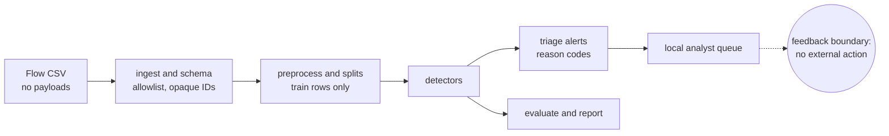

# infra-ids: an independent research companion

**Question.** The article *AI-Enhanced Cyber Threat Detection and Response Advancing National Security in Critical Infrastructure*
(Journal of Posthumanism 5(3), 2025, [doi:10.63332/joph.v5i3.965](https://doi.org/10.63332/joph.v5i3.965)) argues that AI-based intrusion detection
helps defend critical infrastructure. It reports no dataset, split or score. This repository asks the part of that question a public dataset can answer:
*on pre-recorded flow records, how do a reference, a rule, a tree, an anomaly detector and a small neural network compare, what triggered each alert, and
what disposition did a local workflow record?*

Maintainer: Partha Chakraborty ([@parthachk64-cyber](https://github.com/parthachk64-cyber)); one of nine authors of the article. This code is **not** the article's code
and none exists in the sources checked. The article is credited separately in [CITATION.cff](CITATION.cff); its authors did not write this software.

**What you can run:** an offline detector comparison, an inspectable alert, a local analyst-disposition log, and a report that regenerates every table and plot from saved files.
It never touches live networks, payloads or enforcement tools.

## Results

Counts and rates below are generated from saved files by `python -m infra_ids report --run <run> --update-readme`; `--check` fails CI if they go stale.
Table A describes how the *paper's authors coded four cases*; Table B is *measured in this repository* on one public benchmark. They are different kinds of evidence and are never combined.

<!-- BEGIN GENERATED:table-a -->
**Table A. What the paper records in its four energy cases**

| Feature marked by the authors | Case columns marked | Case columns examined |
|---|---|---|
| Phishing | 3 | 4 |
| Ransomware deployment | 1 | 4 |
| SCADA exploitation | 2 | 4 |

*Counts derived from the authors' case matrix* (paper Table 1, printed p. 1673; columns: Colonial Pipeline 2021, Ukraine power grid 2015/2016 as one column, Triton 2017, BlackEnergy 2014). Each count describes how the authors coded four selected cases; it cannot estimate how often a threat occurs across the energy sector and is not independent incident verification. All nine features: [data/paper/energy_case_counts.csv](data/paper/energy_case_counts.csv).
<!-- END GENERATED:table-a -->

<!-- BEGIN GENERATED:table-b -->
**Table B. How the six detectors performed on the same held-out records: Detectors on the UNSW-NB15 test partition**

| Model | Test N | Precision | Recall | F1 | False-positive rate |
|---|---|---|---|---|---|
| majority reference | 82,332 | 0.551 | 1.000 | 0.710 | 1.000 |
| rule baseline | 82,332 | 0.820 | 0.656 | 0.729 | 0.176 |
| decision tree | 82,332 | 0.798 | 0.973 | 0.877 | 0.301 |
| isolation forest | 82,332 | 0.735 | 0.848 | 0.787 | 0.375 |
| MLP | 82,332 | 0.816 | 0.985 | 0.892 | 0.273 |
| isolation forest + rule | 82,332 | 0.731 | 0.851 | 0.786 | 0.384 |

*Dataset: UNSW-NB15 official training/testing partitions (independent benchmark). Split: provider's held-out test file, n=82,332 (45,332 attack, 37,000 normal). Positive class: label 1 (attack). Thresholds: each detector's own, chosen to maximise F1 on a validation split of the training file (reference models use a fixed 0.5). Run ID: `20261126T025949Z-s42`, seed 42, source revision `af83f33393`.* Undefined ratios are `n/a`. Download: [results/unsw-nb15-example/20261126T025949Z-s42/table_b.csv](results/unsw-nb15-example/20261126T025949Z-s42/table_b.csv) (adds accuracy and confusion counts). Errors and timing: [docs/results.md](docs/results.md).
<!-- END GENERATED:table-b -->

Read Table B carefully: false-positive rates of 17% to 38% are not deployable; adding the rule to the anomaly detector changed F1 by -0.001; 10.4% of test rows have an exact
feature duplicate in the training file (524 with a conflicting label), which is why every report repeats the metrics without them. This is one lab dataset and says nothing about
national-security outcomes. Details: [docs/results.md](docs/results.md).

## Evidence labels

Everywhere in this repository: **paper reports**, **companion implementation** (a choice made here), **measured in this run**, **unavailable in source**.
The paper's claims are located by page, figure and table in [docs/paper-map.md](docs/paper-map.md). Synthetic-fixture results are always labelled
"synthetic demonstration" and never mixed with the benchmark.

## Architecture



See [docs/architecture.md](docs/architecture.md).

## Five-minute quick start (fresh virtual environment, Python 3.11+)

```bash
python -m venv .venv && source .venv/bin/activate      # Windows: .venv\Scripts\activate
python -m pip install -e ".[dev]"
python -m infra_ids demo --seed 42 --out runs/demo     # synthetic demonstration, about a minute
python -m infra_ids report --run runs/demo             # regenerate tables, plots, report.md
python -m pytest --cov=infra_ids --cov-report=term-missing --cov-fail-under=80
```

Each run is written to `runs/demo/<run-id>/` and never overwrites an earlier one; `runs/demo/LATEST` names the newest. Open its `report.md`, then
`alerts.jsonl` (what triggered each alert) and `queue.jsonl` (the disposition history). A committed example is in `results/synthetic-demo-example/`.

### Independent benchmark

Download UNSW-NB15's `UNSW_NB15_training-set.csv` and `UNSW_NB15_testing-set.csv` from the [provider](https://research.unsw.edu.au/projects/unsw-nb15-dataset)
(academic use; not redistributed here, see [docs/data.md](docs/data.md)), then:

```bash
python -m infra_ids benchmark --train-csv <training.csv> --test-csv <testing.csv> --seed 42 --out runs/benchmark
python -m infra_ids report --run runs/benchmark
```

This takes tens of minutes on a laptop (Isolation Forest scoring dominates). If the files are missing the command stops with the missing path and exit code 2;
it never falls back to synthetic data.

## Trace a result to its source

`report.md` -> `manifest.json` (input SHA-256, seed, versions, thresholds, source revision) -> `predictions.csv` (opaque row IDs, scores, decisions) -> code in `src/infra_ids/` -> the claim in `docs/paper-map.md`.

## Layout

`src/infra_ids/` package · `data/` fixture generator, checksums, `cases.csv` · `tests/` · `docs/` · `results/` committed example runs · `requirements.lock` pinned versions used.

## Licences and rights

Code: MIT (Partha Chakraborty). The article is CC BY-NC-ND 4.0 and its text and figures are not reproduced here; figures are redrawn originally. UNSW-NB15: free for academic research,
commercial use to be agreed with its authors; not redistributed. Dependencies keep their own licences (numpy, pandas, scikit-learn, matplotlib: BSD-style/PSF).

## Limits

Public lab flow records are not critical-infrastructure data; there are no sequences, timestamps or deployment logs; the interviews the article mentions are unavailable; SVM, CNN and RNN are discussed
in the article but not implemented (reasons in `docs/paper-map.md`). Treat the numbers as a worked, reproducible comparison, not as evidence that any system is safe to deploy.

## Committed example runs

`results/synthetic-demo-example/` is a complete demo run (inputs hashed in its manifest, source revision recorded). `results/unsw-nb15-example/` holds the benchmark's manifest, metrics,
report, latency and plots; its `predictions.csv` (82k rows) is not committed, so run `benchmark` to regenerate the full set. A second benchmark run at the recorded revision reproduced every count identically.
