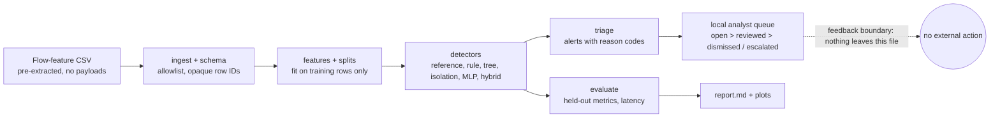

# Architecture

The analyst's question: *which pre-recorded events warrant review, what triggered the alert, and what disposition did the local
workflow record?* One path answers it; every stage writes something you can open.

The dotted edge is the boundary: "escalated" is a row in `queue.jsonl`. No code sends, blocks, quarantines or calls out.

| Stage | Module | Output | Notes |
|---|---|---|---|
| Import | `schema.py`, `ingest.py` | validated frame, input manifest | feature allowlist; file size cap; `.csv` only; duplicate ids keep first and are counted; row ids are `sha256(partition|id)[:12]` |
| Prepare | `features.py`, `splits.py` | preprocessor, split manifest | signed log1p, standardise (train mean/std), top-20 one-hot; validation split is group-aware so exact duplicates share a side |
| Detect | `detectors.py`, `train.py` | scores in [0,1], thresholds | all choices below are this repository's, not the paper's |
| Triage | `triage.py` | `alerts.jsonl` | event id, model version, risk score, threshold, reason codes, proposed action |
| Record response | `response.py` | `queue.jsonl` | append-only history; illegal transitions raise; a repeated event id changes nothing |
| Evaluate | `evaluate.py`, `report.py` | `metrics.csv`, plots, `report.md` | report regenerates from `predictions.csv` + `manifest.json` only |
| Run | `pipeline.py`, `cli.py` | `runs/<base>/<run-id>/` | a new run never overwrites an old one; `LATEST` points at the newest |

## Detector choices (companion implementation)

Positive class is label 1 (attack). Every score is in [0,1], higher = more suspicious. A record is flagged iff `score >= threshold`.

- **majority_reference**: predicts the majority training label for every row (constant score; no average precision).
- **rule_baseline**: flag if R1 (`ct_srv_dst >= 8` and `ct_dst_ltm >= 8`: a fan-in burst toward one service/destination) or R2 (`dpkts == 0` and `spkts >= 2`: sent, nothing returned). Clauses were fixed from the documented meaning of the fields before any test partition was scored.
- **decision_tree**: depth 8, min 20 samples per leaf; score = leaf probability of class 1.
- **isolation_forest**: 200 trees fitted on label-0 fit rows only. Raw anomaly = -`score_samples`; normalised by the empirical CDF over the fit-row normal scores, so a score is the share of normal training records that scored lower.
- **mlp**: hidden layers (32, 16), early stopping, up to 200 iterations; score = class-1 probability.
- **hybrid_iso_rule**: `s = 1 - (1 - s_iso) * (1 - w * r)` with `w = 0.5` and `r` = 1 when R1 or R2 fires. A rule hit moves the score halfway to 1; no hit leaves it unchanged. It reuses the same fitted Isolation Forest, so the with/without-rule comparison is like for like.
- **Thresholds**: for the tree, isolation forest, MLP and hybrid, the threshold maximising F1 on the validation rows (ties to the higher value). The majority and rule references use a fixed 0.5 cut on their own 0/1 scores. No threshold, scaler or category list sees the test partition.

## Triage and the response workflow

`proposed_action` is `expedite_analyst_review` when a rule reason code accompanies the alert, else `analyst_review`. Reason codes are:
`SCORE_ABOVE_THRESHOLD`, rule codes (`R1_FANIN_BURST`, `R2_UNANSWERED`) and up to three `DEV:<feature>` codes naming numeric features that sit at least
3 standard deviations from the normal-record profile. Only identifiers and codes are logged, never feature values.

The demo and benchmark runs apply a **simulated** analyst policy (escalate when a rule code is present, else dismiss) on a simulated clock. It uses
alert content only, never labels. Its delays are generated numbers and are reported separately from inference latency. They are not an incident response time.

## Safety posture

No live capture, payloads, exploit generation or enforcement. Inputs are bounded, schema-checked CSV. Models are **not pickled**: a run is rebuilt
deterministically from the seed, so no serialised artifact is ever loaded. Paths are resolved and restricted to existing `.csv` files.
